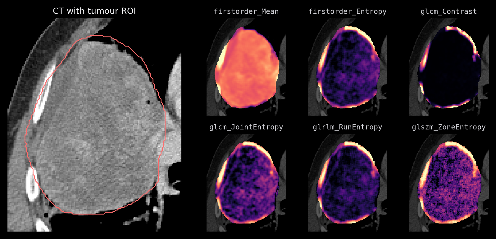

<div align="center">

# mlx-radiomics

Extract radiomics features and voxel maps on the Apple Silicon GPU with native MLX.

[](https://pypi.org/project/mlxradiomics/)
[](https://pypi.org/project/mlxradiomics/)
[](https://github.com/MedMLX/mlx-radiomics/blob/main/LICENSE)
[](https://github.com/ml-explore/mlx)
[](https://github.com/MedMLX/medmlx)

[Getting started](https://github.com/MedMLX/mlx-radiomics/blob/main/docs/guide/getting-started.md) · [Python API](https://github.com/MedMLX/mlx-radiomics/blob/main/docs/guide/python-api.md) · [Feature catalogue](https://github.com/MedMLX/mlx-radiomics/blob/main/docs/guide/features.md)



</div>

| Input | Output |
| :--- | :--- |
| Aligned image + integer label mask | ROI features (JSON/CSV) or one float32 NIfTI map per feature |

PyRadiomics feature names and parameter files, with configurable IBSI conventions. No
model weights to download. Requires Apple Silicon with Metal.

## Install

```bash
uv venv --python 3.13
source .venv/bin/activate
uv pip install "mlxradiomics>=1.0.1"
```

| Extra | Adds |
| :--- | :--- |
| `mlxradiomics[lbp]` | LBP3D derived images |
| `mlxradiomics[viz]` | Static feature-map figures: `mlxradiomics.viz` provides five perceptually uniform palettes with reversed variants, ROI overlays, whole-ROI histograms, and PNG/PDF/SVG export |

See the [visualization guide](https://github.com/MedMLX/mlx-radiomics/blob/main/docs/guide/visualization.md) and
[runnable example](https://github.com/MedMLX/mlx-radiomics/blob/main/examples/visualize_feature_maps.py).

## Python API

Start with image and mask files to preserve their physical geometry. Arrays use the
same settings and result contract:

```python
from mlxradiomics import Settings, extract_files

result = extract_files(
    "image.nii.gz", "mask.nii.gz",
    settings=Settings(label=1, bin_width=25, features=("firstorder_Mean", "glcm_Contrast")),
)
mean = result.features["original_firstorder_Mean"]
```

Add `mode="voxel"` for maps in memory. Use `export_files` to write voxel maps
without retaining every map in memory. `export` and `export_files` write maps,
not ROI tables; the file runner below writes ROI JSON/CSV.

**Conventions:** defaults follow IBSI, even when using PyRadiomics feature names
or parameter files. Select alternative definitions through individual `Settings`
fields.

### Arrays and maps

```python
from mlxradiomics import Settings, extract, extract_files, export_files

settings = Settings(label=2, features=("firstorder_Mean", "glcm_Contrast"))

roi = extract(image, mask, spacing=(3.0, 1.0, 1.0), settings=settings)
mean = roi.features["original_firstorder_Mean"]  # float

voxel = extract_files("image.nii.gz", "mask.nii.gz", settings=settings, mode="voxel")
mean_map = voxel.features["original_firstorder_Mean"]  # float64 NumPy array

saved = export_files(
    "image.nii.gz", "mask.nii.gz", "outputs/maps", settings=settings,
)
saved.report                                 # pathlib.Path to features.json
saved.maps["original_firstorder_Mean"]        # pathlib.Path to a float32 NIfTI
saved.metadata["settings"]                   # effective extraction settings
```

| Operation | Arrays | NIfTI/NRRD files | Result |
| --- | --- | --- | --- |
| ROI features | `extract(image, mask)` | `extract_files(image_path, mask_path)` | `Result[float]` |
| Voxel maps in memory | `extract(image, mask, mode="voxel")` | `extract_files(image_path, mask_path, mode="voxel")` | `Result[NDArray[np.float64]]` |
| Voxel maps on disk | `export(image, mask, output_dir)` | `export_files(image_path, mask_path, output_dir)` | `MapExport(report, maps, metadata)` |

Options are keyword-only:

| Option | Sets |
| :--- | :--- |
| `settings=` | Features and binning |
| `transforms=` | Derived images |
| `spacing=` | Array voxel sizes in NumPy axis order |

- **Geometry:** file operations read geometry from the image. Array extraction warns
  when `spacing` is omitted and assumes 1 mm on each axis. Array `export` writes zero
  origin and identity direction; use file operations for scanner-aligned output, or
  explicitly acknowledge synthetic coordinates with `allow_synthetic_geometry=True`.
- **Precision:** feature arithmetic is float32. In-memory float64 maps hold those float32
  results, not higher-precision calculations; saved maps and streamed batches are
  float32.

Extraction results expose `.features` and `.metadata`; exports expose `.report`,
`.maps` and `.metadata`. The [Python guide](https://github.com/MedMLX/mlx-radiomics/blob/main/docs/guide/python-api.md)
covers settings, streaming voxel batches and multi-case studies. The
[visualization guide](https://github.com/MedMLX/mlx-radiomics/blob/main/docs/guide/visualization.md)
covers figure export.

## Parameter files

The supported PyRadiomics sections are `setting`, `imageType` and `featureClass`.
Unsupported keys, image types and per-image overrides raise `InvalidInputError`.

```yaml
setting:
  binWidth: 25
  label: 1
  resampledPixelSpacing: [1.0, 1.0, 1.0]
  interpolator: sitkLinear
  padDistance: 1
imageType:
  Original: {}
  Wavelet:
    level: 1
featureClass:
  firstorder: [Mean, Entropy]
  glcm: [Contrast, JointEntropy]
```

| `imageType` keys | Status |
| :--- | :--- |
| `Original`, `Square`, `SquareRoot`, `Logarithm`, `Exponential`, `Gradient`, `Wavelet`, `LoG`, `LBP2D`, `LBP3D`, `Mean`, `Laws`, `Gabor`, `SeparableWavelet` | Supported |
| `Simoncelli` (alias `NonseparableWavelet`), `Riesz` | Recognized but cannot run on this release; see [Limits](#limits) |

See [parameter files](https://github.com/MedMLX/mlx-radiomics/blob/main/docs/guide/parameters.md) for filter options and
[conventions](https://github.com/MedMLX/mlx-radiomics/blob/main/docs/guide/python-api.md#conventions) for definition settings.

## Features

Use `list_features("firstorder", "glcm")` to select whole families, or
`list_features(mode="voxel", ndim=3)` to discover names supported in that mode.
Pass its result as `Settings(features=...)`. Selecting a family does not change
binning or numerical conventions.

`mlxradiomics.FEATURES` lists all 190 names, including all 116 non-deprecated
PyRadiomics features. Without a `features` selection, extraction returns the 93
PyRadiomics intensity and texture features; request shape and the other families
by name.

| Family | Count | Modes |
| --- | ---: | --- |
| `firstorder` | 21 | ROI, voxel |
| `intensityhistogram` | 23 | ROI, voxel |
| `glcm` | 26 | ROI, voxel |
| `gldm` (NGLDM) | 17 | ROI, voxel |
| `ngtdm` | 5 | ROI, voxel |
| `glrlm` | 16 | ROI, voxel |
| `glszm` | 16 | ROI, voxel |
| `gldzm` | 16 | ROI, voxel |
| `ivh` | 7 | ROI, voxel |
| `localintensity` | 2 | 3D ROI |
| `shape` | 32 | 3D ROI |
| `shape2D` | 9 | 2D ROI, or one slice of a 3D ROI |

Calculation conventions such as kurtosis, shape covariance divisor, NGTDM
singular cases and fixed-bin-size origin are independent `Settings` fields with
IBSI defaults. Select each alternative explicitly; see
[Conventions](https://github.com/MedMLX/mlx-radiomics/blob/main/docs/guide/python-api.md#conventions).
The [feature catalogue](https://github.com/MedMLX/mlx-radiomics/blob/main/docs/guide/features.md#catalogue) lists public names and
their IBSI identifiers.

## MedMLX and automation

The [MedMLX MCP server](https://github.com/MedMLX/medmlx/blob/main/docs/mcp.md) installs this runtime and lets an AI agent describe, check and run `mlxradiomics`.

```sh
uv tool install --python 3.13 "medmlx[vision,mcp]"
MEDMLX="$(uv tool dir --bin --color never)/medmlx"
mkdir -p "$HOME/medmlx-work"
claude mcp add --scope user medmlx -- "$MEDMLX" serve --root "$HOME/medmlx-work"
```

For Codex, use `codex mcp add medmlx -- "$MEDMLX" serve --root "$HOME/medmlx-work"`. Other MCP clients take the same command and arguments. The same install provides the `medmlx` CLI, for example `medmlx describe mlxradiomics`.

The MCP `run_model` tool takes the arguments of `mlxradiomics.medmlx.run` below.

### File runner

```python
from mlxradiomics.medmlx import run

result = run(image_path="image.nii.gz", mask_path="mask.nii.gz", output_dir="features")
result["files"]["features_json"]  # path to the report
```

### Inputs and outputs

Use a 2D or 3D NIfTI/NRRD image and an integer label mask on the same grid. `label`
defaults to 1. Set `overwrite=True` to replace existing outputs.

| Mode | Writes |
| :--- | :--- |
| ROI (default) | `features.json` and `features.csv` |
| `voxel=True` | float32 NIfTI maps under `maps/`, zero outside the ROI |

Feature keys include image, family and name, such as `original_glcm_Contrast`.
The result contains `outputs`, `files` and `details`. See the
[runner guide](https://github.com/MedMLX/mlx-radiomics/blob/main/docs/guide/runner.md)
for all arguments, report fields, geometry and error handling.

## Limits

- Shape and local intensity are ROI-only; local intensity needs 3D input.
- Simoncelli and Riesz filters are unavailable on this release; see the limits guide.
- Feature arithmetic is float32. Undefined values are NaN; overflow is infinity.
- Read voxel maps with NiBabel; SimpleITK reads stored NaN voxels as zero.
- Detached inputs such as `.nhdr` require a new output directory, even with
  `overwrite=True`.

See [limits](https://github.com/MedMLX/mlx-radiomics/blob/main/docs/guide/limits.md)
for filter requirements and supported inputs, and the
[environment guide](https://github.com/MedMLX/mlx-radiomics/blob/main/environment/README.md)
for development.

## License

[Apache-2.0](https://github.com/MedMLX/mlx-radiomics/blob/main/LICENSE). See [third-party notices](https://github.com/MedMLX/mlx-radiomics/blob/main/THIRD_PARTY_NOTICES.md), including CC BY 4.0 attribution
for adapted IBSI manifest definitions.
